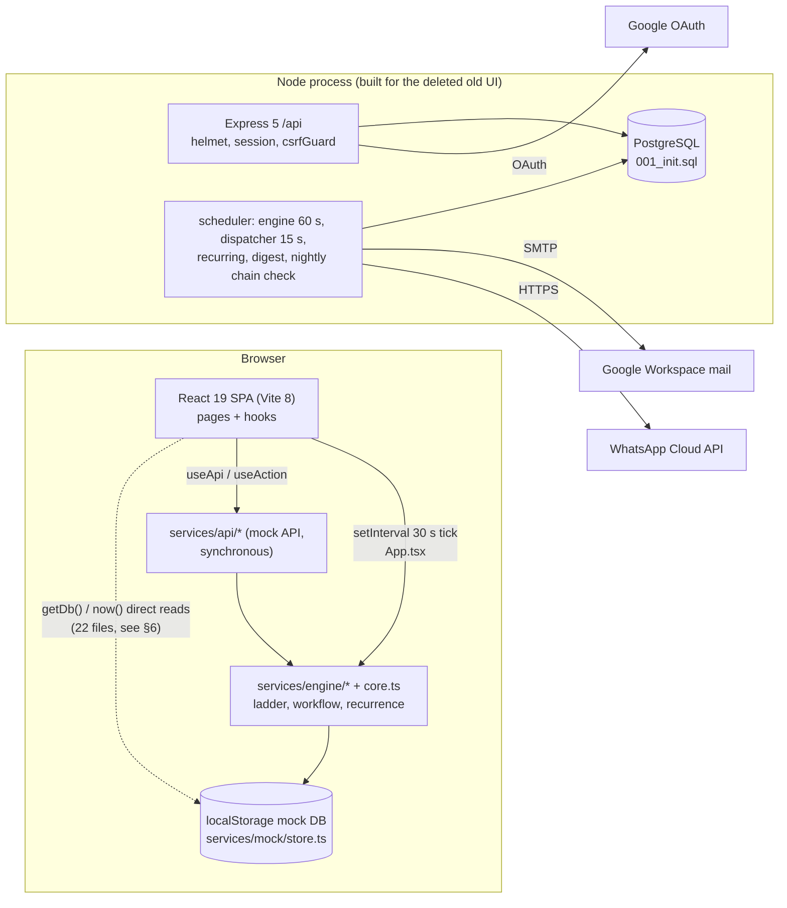
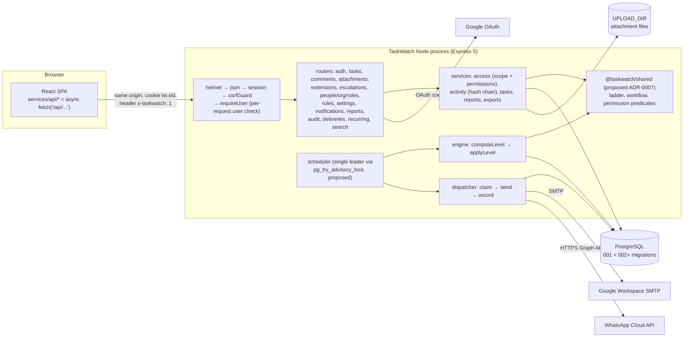
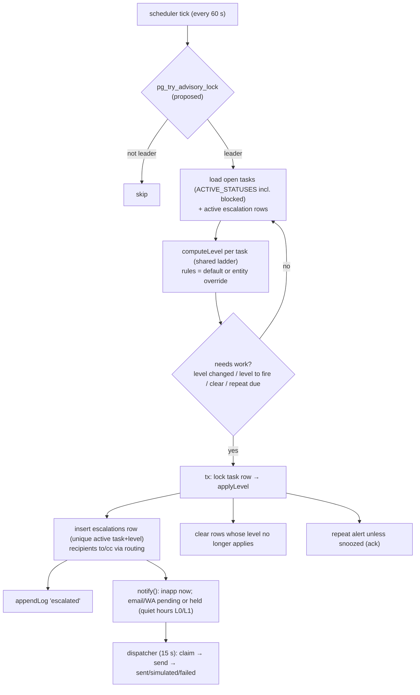

# System Architecture

> Evidence tags: **[WO]** Work Order FO-2026-OPS-01 (wins over the prototype) · **[V-C]** client code · **[V-S]** server code · **[A]** assumption · **[OPEN]** D-number in [OPEN_QUESTIONS.md](../01-discovery/OPEN_QUESTIONS.md).
> Server facts are summarised from [EXISTING_SYSTEM_ANALYSIS.md](../01-discovery/EXISTING_SYSTEM_ANALYSIS.md); gaps from [FEATURE_GAP_ANALYSIS.md](../01-discovery/FEATURE_GAP_ANALYSIS.md); decisions in [decisions/](decisions/README.md).
> Nothing here was run: no server, migration or test was executed while writing this document.

Related: [DATABASE_DESIGN.md](DATABASE_DESIGN.md) · [API_CONTRACTS.md](API_CONTRACTS.md) · [SECURITY_ARCHITECTURE.md](SECURITY_ARCHITECTURE.md) · [SCALABILITY_AND_RELIABILITY.md](SCALABILITY_AND_RELIABILITY.md) · [INTEGRATION_DESIGN.md](INTEGRATION_DESIGN.md)

## 1. Current architecture (as observed, 2026-11-03)

Two halves that do not talk to each other:



- Client runs entirely on the mock; there is no `/api` proxy [V-C `client/vite.config.ts:4-8`]. The escalation engine runs in the browser [V-C `client/src/app/App.tsx:62-72` per EXISTING_SYSTEM_ANALYSIS §2.2].
- Server: middleware order helmet → JSON (200 kb) → session → csrfGuard → routers [V-S `server/src/app.ts:23-62`]; in production it also serves `client/dist` [V-S `app.ts:65-69`]; it applies migrations then starts the scheduler in the same process [V-S `server/src/index.ts:9, 18`].

## 2. Target architecture

ADR-0001 (evolve the server), ADR-0008 (standalone). Same-origin, one Node process, one Postgres.



### 2.1 Components

| Component | Responsibility | Status | Evidence |
|---|---|---|---|
| SPA | Screens; calls `/api` only; shows server-computed allowed actions; no business rules except the policy simulator (POL-02) | Existing UI; data layer to be rewired | [V-C `client/src/services/api/*`] |
| API (Express) | AuthN, authZ, validation, transactions, activity/audit logging, C-7 re-evaluation after mutations | Existing; routes reshaped | [V-S `server/src/app.ts`] |
| Scheduler jobs | engine 60 s (`ENGINE_INTERVAL_MS`), dispatcher 15 s, recurring 60 s, weekly digest, nightly chain check | Existing; add leader lock (proposed) | [V-S `server/src/jobs/scheduler.ts:67-76`, `config.ts:67-68`] |
| Engine | Computes level per open task; fires/clears escalation rows; repeat alerts; row lock per task | Existing; status set and event fields extended | [V-S `server/src/engine/engine.ts:37-80`] |
| Dispatcher | Claims due email/WhatsApp rows (`for update skip locked`), sends, records outcome; 3 attempts, linear 5-minute backoff | Existing; add stuck-`sending` recovery (proposed) | [V-S `server/src/notify/dispatcher.ts:6, 35-81`] |
| Postgres | System of record, sessions, job dedupe | Existing; migrations 002+ | [V-S `server/src/db/migrations/001_init.sql`] |
| SMTP (Google Workspace) | Email, sender name "TaskWatch" | Existing | [V-S `server/src/notify/channels.ts:74-91`; WO p.4] |
| WhatsApp Cloud API | Template messages | Existing | [V-S `channels.ts:25-54`; WO p.4] |
| Google OAuth | Workspace SSO | Existing | [V-S `server/src/routes/auth.ts:33-76`] |
| Password + TOTP | Second sign-in path (ADR-0002) | New | — |
| Upload storage | Local directory `UPLOAD_DIR` | Existing | [V-S `config.ts:64-65`] |

Integration details: [INTEGRATION_DESIGN.md](INTEGRATION_DESIGN.md).

## 3. Request flow (target)

```mermaid
sequenceDiagram
  participant B as SPA
  participant M as Middleware
  participant H as Route handler
  participant S as Service (tx)
  participant D as Postgres
  B->>M: POST /api/tasks/TW-12/progress (cookie, x-taskwatch: 1, JSON)
  M->>M: helmet headers, JSON ≤200 kb, session lookup
  M->>M: csrfGuard (header on non-GET) → 403 if missing
  M->>D: requireUser: select user by id (active? roles?) → 401 if not
  M->>M: idle/absolute session limits → 401 SESSION_EXPIRED
  H->>H: zod schema (strict: unknown keys rejected) → 422 {error, fields}
  H->>S: progress(user, taskId, input)
  S->>D: begin; select task for update
  S->>S: canViewTask → 404; allowedActions has 'progress' → 403; transition → 409
  S->>S: sensitive-ID guard on free text → 422
  S->>D: update task; appendLog (hash chain); admin_log row where audited
  S->>D: notify(): insert inapp/email/whatsapp rows (prefs, quiet hours)
  S->>D: applyLevel(task) (C-7 re-evaluation); commit
  S-->>B: 200 {task view, allowed actions}
  S->>S: kickDispatcher() after commit
```

Status codes and envelope: [API_CONTRACTS.md §1](API_CONTRACTS.md). Since T-1.11 (2026-11-04) zod errors return **422 with `fields`** and Postgres constraint errors map to 409/422 [V-S `server/src/http/middleware.ts` `errorHandler`].

## 4. Engine flow (target)



- Runs every 60 s by default, inside the WO's "at least every 5 minutes" [WO FR-8; V-S `config.ts:67`].
- Due-soon and overdue notices (ESC-07) are new engine outputs: one per task per due date, deduplicated through a unique key (see [DATABASE_DESIGN.md §3.8](DATABASE_DESIGN.md)).
- Recurring generation and digests run as separate jobs [V-S `scheduler.ts:71-72`].

## 5. Boundaries and invariants
- **Server time only**: every timestamp comes from `clock.now()` on the server [WO p.5; V-S `server/src/clock.ts`]. Client-supplied times are only "due date/time" inputs, interpreted in a time zone still to be confirmed [D-5, decided].
- **One source of rules**: ladder, transitions, permission predicates in one module (ADR-0007, proposed).
- **Evidence is append-only**: `activity_log` and `admin_log` reject UPDATE/DELETE/TRUNCATE by trigger [V-S `001_init.sql:104-112, 195-198`].
- **Every mutation that can change escalation state re-evaluates it in the same transaction** (C-7), as `applyLevel` is used today [V-S `services/tasks.ts:159`].
- **Dev/demo tools are impossible in production** (`config.ts:60-62` forces them off when `NODE_ENV=production`).

## 6. Replacing the client's direct store reads

A grep (2026-11-03) finds **22 UI files importing the mock store** (21 calling `getDb()`) [V-C grep of `client/src/{app,features,hooks,utils}`]. Each read must come from an endpoint in [API_CONTRACTS.md](API_CONTRACTS.md). The main new endpoint is a **bootstrap** `GET /api/me` (user, effective permissions, settings subset, rules for the user's entity, nav badge counts, server time), which removes most small reads.

| File:line [V-C] | What it reads directly | Replace with |
|---|---|---|
| `app/App.tsx:23, 39` | session user; route `allow(db, user)` guards | `GET /api/me` (user + permissions); route guards use `permissions[]` |
| `app/App.tsx:62-72` (per analysis) | 30 s browser engine tick | **Delete**; server scheduler (ESC-08) |
| `app/SearchPalette.tsx:40` | `hasPerm(db, …, 'manage_staff')` | `me.permissions` |
| `app/Shell.tsx:22` | unread count, escalation count, queue badges | `GET /api/me` → `badges` |
| `app/Shell.tsx:42` | store subscription for rerender | react-query invalidation |
| `app/Shell.tsx:244` | latest 8 notifications for the bell | `GET /api/notifications?limit=8` |
| `features/account/AccountPages.tsx:80` | prefs/channels context | `GET /api/me/prefs` + `GET /api/me` (WhatsApp number/opt-in) |
| `features/admin/AuditPage.tsx:13` | users/teams for filter options and names | names embedded in `GET /api/audit` rows; filter options from `GET /api/people?fields=min` (scoped) |
| `features/admin/DeliveryLogPage.tsx:32, 54, 104` | user name per delivery | `recipient {id, name}` embedded in `GET /api/deliveries` rows |
| `features/auth/AuthPages.tsx:55` | demo user list | **Delete** in production; dev only `GET /api/auth/dev-users` (non-production) |
| `features/dashboard/DashboardPage.tsx:33, 81, 99, 222, 271, 353, 453, 484` | org name, raw tasks/users/escalations for widgets (unscoped — DASH-03) | `GET /api/dashboard` returns every widget's data, computed over the viewer's scope |
| `features/demo/DemoBar.tsx:22` | demo state | Dev only: `GET/POST /api/dev/clock` (CoS + `DEMO_TOOLS`); hidden in production [D-17, decided] |
| `features/notifications/NotificationsPage.tsx:73` | deliveries per notification | `deliveries[]` embedded in each `GET /api/notifications` item |
| `features/org/OrgPage.tsx:15, 26, 179` | open/overdue counts per person; teams | `GET /api/org` (users with counts, teams, entities) |
| `features/reports/ReportsPages.tsx:78` | filter option lists (all users/teams — RPT-04) | `GET /api/reports/options` (scoped) |
| `features/staff/StaffPages.tsx:30, 155` | teams, users for form selects | `GET /api/org` (scoped) |
| `features/staff/TeamPage.tsx:17` | reports of the user | `GET /api/team` (DASH-02) |
| `features/tasks/shared.tsx:62` | `allowedActions(getDb(), …)` per row | `actions[]` on each `TaskView` row (WF-10) |
| `features/tasks/TaskDetailPage.tsx:44` | `silenceThresholds(…, db.rules)` | `levelInfo` + `rules` on `GET /api/tasks/:id` |
| `features/tasks/TaskDialogs.tsx:57, 162, 218` | reviewer, requester, assignee names | `people` map on `GET /api/tasks/:id` (only people referenced by the task — fixes TASK-05 leak) |
| `features/tasks/TaskFormPage.tsx:48` | categories, teams, defaults | `GET /api/me` (`settings.categories`) + `GET /api/tasks/options` |
| `features/work/EscalationsPage.tsx:27` | names, teams | embedded in `GET /api/escalations` rows |
| `features/work/QueuePages.tsx:14, 82` | recent reviews by me; user names | `GET /api/reviews?mine=decided` ; names embedded in `GET /api/extensions` |
| `features/work/RecurringPage.tsx:109` | `settings.categories` default | `GET /api/me` (`settings.categories`) |
| `hooks/index.ts:65` | `hasPerm(getDb(), …)` | `me.permissions` |
| `features/tasks/CalendarPage.tsx`, `utils/format.ts:2` | `now()` (simulated clock) | `me.serverTime` offset (keeps demo clock working in dev) |

Also: synchronous `useMemo` calls to `assigneeOptions`, `parentOptions`, `search` become `useApi` queries [FEATURE_GAP_ANALYSIS §5.4]; `vite.config.ts` needs a dev proxy `/api → http://localhost:4000` (the server comment already expects it [V-S `server/src/config.ts:27`]).

## 7. Proposed new questions (D-60+)

> **Superseded:** consolidated with defaults in [OPEN_QUESTIONS §8](../01-discovery/OPEN_QUESTIONS.md), which is authoritative. Duplicates there point to a canonical D-number.

Raised while writing the architecture docs. **Not yet added to [OPEN_QUESTIONS.md](../01-discovery/OPEN_QUESTIONS.md)**; numbers are proposals for the owner of that file.

| # | Question | Contradiction / evidence | Proposed answer |
|---|---|---|---|
| D-60 | When a user asks for a task/person they may not see, return 404 or 403? | PRD C-3 and server return 404 [V-S `server/src/routes/tasks.ts:135`]; prototype returns 403 [V-C `client/src/services/authz/permissions.ts:85`, `engine/workflow.ts:76`] | 404 |
| D-61 | Can the Settings simulation toggles force simulation when real credentials exist? | client `Settings.emailSimulation/whatsappSimulation` [V-C `types/index.ts:336-338`] vs env-derived simulation [V-S `config.ts:42, 50`] | Yes, force-simulate only; never force live |
| D-62 | Are `digestDay`/`digestHour` still editable in Settings, given D-14 fixed the digest at Monday 09:00 IST? | [V-C `types/index.ts:345-346`]; PRD SET-01 vs D-14 / WO FR-12 | Remove or show read-only |
| D-63 | Does the assigner pick the entity on the task form, or is it always derived from team/assignee? | WO FR-1 lists entity as an assignment field [WO p.3]; D-4 derives it | Derive; show read-only |
| D-64 | Is relying on Workspace 2-Step Verification (not verifiable by TaskWatch) acceptable for Manager/CoS/CEO Google sign-ins, and who confirms Workspace enforces it? | WO requires 2FA for these roles [WO p.5]; D-21 | Yes, with written confirmation from the Workspace admin |
| D-65 | If a Manager/CoS/CEO loses their authenticator, who may reset their TOTP, and are recovery codes issued? | ADR-0002; no spec | CoS (or `manage_staff`) resets, audited; 10 one-time recovery codes (aligned with OPEN_QUESTIONS §8.4) |
| D-66 | What happens to closed tasks and logs after 7 years: keep, export to cold archive, or purge? | WO "kept for 7 years … archived, never deleted" [WO p.5] | Keep (no purge job) until decided |
| D-67 | How are teams, team leads and entity heads created and edited, and which team does each existing user join? | client has no team/entity CRUD (`getOrg`, `setTeam` only [V-C `api/admin.ts:168-198`]); server has no teams | Seed from a list supplied by the Founder's Office; admin CRUD later |
| D-68 | Absolute session lifetime? | none specified; server cookie 12 h rolling [V-S `app.ts:44`] | 12 h |
| D-69 | Which attachment file types are allowed? | none specified (S-5); with [D-13, decided] size | PDF, images, TXT/CSV, Office (DOCX/XLSX/PPTX) |
| D-70 | Does the CEO see all tasks regardless of reporting line? | WO: CEO sees all [WO p.1]; server agrees [V-S `services/directory.ts:90-92`]; prototype only via reporting line [V-C `permissions.ts:64-82`, `mock/seed.ts:48`] | Yes (WO wins) |
| D-71 | While a task is Blocked, does the silence/past-due ladder keep running, and is the "Blocked" alert to the lead held by quiet hours at night? | WO acceptance "alerts the team lead within 5 minutes" [WO p.7] vs quiet hours hold L1 [WO p.5]; server keeps escalating blocked tasks [V-S `engine/engine.ts:41`] | Ladder keeps running; in-app immediate, email/WhatsApp follow quiet hours |
| D-72 | Does approving an assignee's extension use up a lead's single FR-5 due-date change? | WO FR-5 "lead (once)" [WO p.3]; D-6 "both" | Yes |
| D-73 | Which managed secrets store is used in production, and does `server/production.env` (loaded by `npm start`) contain any credential? | WO secrets rule [WO p.5]; `server/package.json` start script | Secrets store injects env; file holds non-secret settings only |
| D-74 | May the assignee comment on their own task? | WO FR-4 names leads, managers and the Founder's Office [WO p.3]; server forbids [V-S `services/access.ts:73`]; PRD CMT-01 allows | Yes (comments never reset the clock) |
| D-75 | Should WhatsApp opt-in default to off for new people? | server default `true` [V-S `001_init.sql:22`]; client field means "has agreed" [V-C `types/index.ts:54`] | Off |

