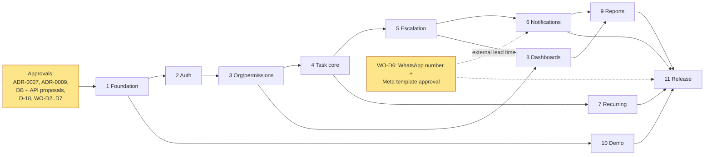

# Implementation Roadmap

> Last updated: 2026-11-03. Evidence tags as in [OPEN_QUESTIONS.md](../01-discovery/OPEN_QUESTIONS.md): **[WO]** · **[V-C]** · **[V-S]** · **[A]** · **[OPEN]**.
> **State on 2026-11-03: no backend work has started and no test has been executed.** Every feature is ANALYSIS, READY or BLOCKED ([IMPLEMENTATION_TRACKER.md](IMPLEMENTATION_TRACKER.md)). The 38 existing server tests are *existing, not run*.
> Companion files: [TASK_BREAKDOWN.md](TASK_BREAKDOWN.md) (tasks `T-<phase>.<n>`) · [REQUIREMENT_TRACEABILITY_MATRIX.md](REQUIREMENT_TRACEABILITY_MATRIX.md) · [MILESTONES.md](MILESTONES.md). This file supersedes the plan section of the first draft [../IMPLEMENTATION_TRACKER.md](../IMPLEMENTATION_TRACKER.md).

## 1. Phases and work packages

Phase names are the ones used in the "Blocks" column of [OPEN_QUESTIONS §8](../01-discovery/OPEN_QUESTIONS.md). Work packages and weeks are from the Work Order, page 6 [WO]. Weeks count from a kickoff date that is **not yet set [OPEN]**.

| # | Phase | WO work package | WO weeks | Planned weeks | Features (canonical IDs, [PRD](../02-product-requirements/PRODUCT_REQUIREMENTS.md)) |
|---|---|---|---|---|---|
| 1 | **Foundation** | WP-1 Foundations | 1–2 | 0–1 | AUTH-06 + cross-cutting C-1…C-7, NFR SEC-3/SEC-7, scheduler leader |
| 2 | **Auth** | WP-1 (single sign-on, 2FA) | 1–2 | 1–2 | AUTH-01, 01a, 01b, 02, 03, 04, 05, 07, 08 |
| 3 | **Org/permissions** | WP-1 (directory, reporting lines, roles) | 1–2 | 2 | STAFF-01…05, ORG-01/02, ROLE-01/02, SET-01 |
| 4 | **Task core** | WP-2 Task core (FR-1…FR-6, log, hash chain) | 2–4 | 2–4 | TASK-01…08, WF-01…11, EXT-01…04, CMT-01…03, ATT-01…03, AUD-01, AUD-02 |
| 5 | **Escalation** | WP-3 Escalation engine (FR-8, FR-9, SLA windows) | 4–5 | 4–5 | ESC-01…09, ESC-06a, POL-01…03 |
| 6 | **Notifications** | WP-4 Notifications (+ FR-12 digest from WP-5) | 5–6 | 5–6 | NTF-01…08, DLV-01/02 |
| 7 | **Recurring** | WP-2 (FR-7) | 2–4 | 4–5, parallel with 5 | REC-01…04 |
| 8 | **Dashboards** | WP-5 Dashboards and reports (FR-10, role views) | 6–8 | 6–7 | DASH-01…03, TASK-09, TASK-10, SRCH-01 |
| 9 | **Reports** | WP-5 (FR-11, CSV and PDF) | 6–8 | 7–8 | RPT-01…07 |
| 10 | **Demo** | — (dev tooling; its production gate is release gate R-S5) | — | 8 | DEMO-01 |
| 11 | **Release** | WP-6 Pilot and rollout | 8–10 | 8–10 | no new feature: pilot, AC-1…AC-10 evidence, go-live |

**Frontend integration is not a phase.** Each phase ends with the client pages for its features calling the new endpoints, replacing their direct mock-store reads ([SYSTEM_ARCHITECTURE §6](../03-architecture/SYSTEM_ARCHITECTURE.md), 22 files). The file-to-phase split is in [TASK_BREAKDOWN.md](TASK_BREAKDOWN.md) (the last task of each phase).

## 2. Dependency graph

Recurring depends only on Task core and the scheduler leader lock, so it runs alongside Escalation. Its assignment notices use the existing notifier [V-S `server/src/notify/notify.ts`]; the reworked preferences arrive in Notifications.

## 3. Phases

The exit criteria of every phase include the [Definition of Done](../04-engineering-standards/DEFINITION_OF_DONE.md) for each feature in it. DoD point 13 (no regression) and the test points need **approved test runs** ([AI_AGENT_GUARDRAILS §2.6](../04-engineering-standards/AI_AGENT_GUARDRAILS.md)).

### Phase 1: Foundation (WP-1)
- **Goal:** one approved data model and API conventions, the shared rules module, and the plumbing every later feature uses, in this order:
  1. ADR approvals and the D-18 data-plan approval (T-1.1)
  2. the shared rules module, if ADR-0007 is approved (T-1.2…T-1.4)
  3. migrations `002`…`006` ([DATABASE_DESIGN §2](../03-architecture/DATABASE_DESIGN.md)), then the existing tests adapted to the new model (T-1.5…T-1.10)
  4. the error envelope: 422 with `fields` (D-80) and 404 for not-visible (D-35) (T-1.11, T-1.12)
  5. rate limiting with 429 and `Retry-After` (D-82) (T-1.13)
  6. the `/api` dev proxy (T-1.14)
  7. the `/api/me` bootstrap, AUTH-06 (T-1.15)
  8. the client fetch adapter that replaces the `services/api` mocks (T-1.16)
  9. a scheduler leader lock (T-1.17)
- **Features:** AUTH-06. Cross-cutting C-1…C-7 ([PRD §2](../02-product-requirements/PRODUCT_REQUIREMENTS.md)).
- **Entry criteria:**
  - ADR-0007 (D-9) and ADR-0009 (D-10) accepted or rejected ([decisions/README](../03-architecture/decisions/README.md)).
  - The proposals in [DATABASE_DESIGN §3–5](../03-architecture/DATABASE_DESIGN.md), the [API_CONTRACTS §2](../03-architecture/API_CONTRACTS.md) endpoint table, and the leader lock in [SCALABILITY_AND_RELIABILITY §2](../03-architecture/SCALABILITY_AND_RELIABILITY.md) approved.
  - **D-18** explicit OK, covering the `pg_dump`, the `taskwatch` reshape and `npm test` dropping `taskwatch_test`. Starting the server also migrates ([V-S] `server/src/index.ts:9`).
  - D-35, D-80 and D-82 answered, or their defaults accepted.
  - D-67 answered (team list for `003_backfill`), or its default accepted.
  - WO-D2, WO-D3, WO-D4, WO-D5 and WO-D7 confirmed by the Founder's Office. The WO asks for this "before Embtel starts WP-1" [WO p.7]. WO-D1 is already answered (D-22, ADR-0008).
- **Exit criteria:**
  - Migrations `002`…`006` applied to `taskwatch` after a backup, with `schema_migrations` showing them.
  - Existing tests adapted with no assertion weakened, and their first approved run recorded.
  - `GET /api/me` serves the [API_CONTRACTS §2.1](../03-architecture/API_CONTRACTS.md) shape.
  - The client talks to the server through the fetch adapter for `/api/me`.
  - One scheduler leader. TC-C3-01 and TC-ESC-08-03 run.
  - **WO AC closed:** none on its own. It lays the base for AC-6 and AC-7.
- **Risks:**
  - D-18 not given. Nothing schema-related can start, and that is almost everything.
  - The backfill hits case-duplicate emails ([DATABASE_DESIGN §4.1](../03-architecture/DATABASE_DESIGN.md)).
  - ADR-0007 is rejected. The ladder and predicates then live twice, against rule G-5.
  - The shared workspace needs `npm install`, which changes the lockfile and needs approval.

### Phase 2: Auth (WP-1)
- **Goal:** Google and password sign-in, with TOTP for anyone holding Manager, CoS or CEO, and secure sessions ([ADR-0002](../03-architecture/decisions/ADR-0002.md), [AUTH-FRD](../02-product-requirements/features/AUTH-FRD.md)).
- **Features:** AUTH-01, 01a, 01b, 02, 03, 04, 05, 07, 08.
- **Entry criteria:**
  - Foundation exit (`005_auth.sql`, rate limiting).
  - D-65 (TOTP reset and recovery codes) and D-68 (absolute session lifetime) answered or defaults accepted.
  - The rate-limit numbers and TOTP parameters marked [A] in [SECURITY_ARCHITECTURE §6](../03-architecture/SECURITY_ARCHITECTURE.md) confirmed.
- **Exit criteria:**
  - DoD for every Auth feature. TC-AUTH-01-01…08, 02-01, 03-01/02, 04-01/02, 05-01 run.
  - A new test case exists for AUTH-07, which has none today (see the [RTM](REQUIREMENT_TRACEABILITY_MATRIX.md)).
  - **WO AC closed:** none directly. It provides the 2FA part of release gate R-S4.
- **Risks:**
  - TOTP built on Node `crypto` alone is security-sensitive code; it needs an RFC 6238 test-vector check.
  - D-89: TaskWatch cannot prove Workspace 2-Step Verification. It needs an admin attestation.

### Phase 3: Org/permissions (WP-1)
- **Goal:** entities and teams, multiple roles with union permissions, a DB permission matrix, and reporting-line scope enforced on the server ([ADR-0004](../03-architecture/decisions/ADR-0004.md)).
- **Features:** STAFF-01…05, ORG-01, ORG-02, ROLE-01, ROLE-02, SET-01.
- **Entry criteria:**
  - Auth exit.
  - D-29, D-33, D-67 and D-75 answered or defaults accepted.
- **Exit criteria:**
  - DoD. TC-STAFF-*, TC-ORG-*, TC-ROLE-*, TC-SET-01-01 and TC-AUTH-06-02 run.
  - WP-1 deliverable "seeded directory for all entities, role tests" [WO] shown.
  - **WO AC closed:** none alone. It is the scope layer AC-6 depends on.
- **Risks:**
  - No source data for teams (D-67).
  - Role changes must reach live sessions (S-9).

### Phase 4: Task core (WP-2)
- **Goal:** FR-1…FR-6 on the new status model ([ADR-0003](../03-architecture/decisions/ADR-0003.md)), both due-date paths ([ADR-0005](../03-architecture/decisions/ADR-0005.md)), and the append-only log with its hash chain.
- **Features:** TASK-01…08, WF-01…11, EXT-01…04, CMT-01…03, ATT-01…03, AUD-01, AUD-02.
- **Entry criteria:**
  - Org/permissions exit.
  - **D-5** (due-time zone) and **D-13** (upload size) answered.
  - D-27, D-30, D-32, D-34, D-69, D-74 and D-83 answered or defaults accepted.
  - D-16 confirmed for the AUD-02 manual button.
  - D-31 (decided) (soft removal of attachments and schedules) added to OPEN_QUESTIONS and answered.
- **Exit criteria:**
  - DoD. WO WP-2 deliverable "task screens, log, API" [WO].
  - **WO AC closed:**
    - AC-4: TC-CMT-01-01, TC-WF-03-01
    - AC-6: TC-TASK-04-01/02, TC-TASK-05-01, TC-SEC1-01
    - AC-7: TC-AUD-01-01…04
    - AC-9 (automated part): TC-TASK-01-06
- **Risks:**
  - Task core is the biggest phase (31 feature IDs) and only two WO weeks long.
  - Legacy log `kind` values have to be mapped at read time ([DATABASE_DESIGN §4.3](../03-architecture/DATABASE_DESIGN.md)).
  - Upload ordering (S-4).

### Phase 5: Escalation (WP-3)
- **Goal:** the server engine on the new statuses and event model, routing over `roles[]`, acknowledgement with a note, per-entity SLA editing ([ADR-0006](../03-architecture/decisions/ADR-0006.md)), and the browser tick removed ([V-C] `App.tsx:62-72`).
- **Features:** ESC-01…09, ESC-06a, POL-01, POL-02, POL-03.
- **Entry criteria:**
  - Task core exit.
  - D-23, D-24, D-25, D-26, D-28 and D-48 answered or defaults accepted.
  - WO-D2, WO-D3, WO-D4 and WO-D7 confirmed (they set the shipped defaults).
- **Exit criteria:**
  - DoD. WP-3 deliverable "engine with automated tests for every rule in this order" [WO].
  - **WO AC closed (automated part):**
    - AC-1: TC-ESC-01-05/06
    - AC-2: TC-ESC-02-01/02/04
    - AC-3 (level part): TC-WF-11-05
  - From here on, the WO's own tasks are tracked in TaskWatch [WO p.6]. That needs a running shared environment.
- **Risks:**
  - D-24 changes the ladder (Blocked counts as L1).
  - Two engines (browser and server) run at once until the tick is deleted.

### Phase 6: Notifications (WP-4; FR-12 digest from WP-5)
- **Goal:** inbox, preferences, dispatcher hardening, quiet hours, the Blocked and chain-break alerts, the delivery log with PII rules, and the weekly digest.
- **Features:** NTF-01…08, DLV-01, DLV-02.
- **Entry criteria:**
  - Escalation exit.
  - D-41, D-42, D-43, D-44, D-52 and D-93 answered or defaults accepted.
  - **WO-D6** (sending number and Meta Business owner) answered, and template approval started early: it has an external lead time.
- **Exit criteria:**
  - DoD. WP-4 deliverable "approved templates, delivery log" [WO].
  - **WO AC closed (automated part):**
    - AC-3: TC-WF-11-02/03/04
    - AC-5: TC-NTF-02-01/02, TC-DLV-01-02
  - FR-12: TC-NTF-05-01.
- **Risks:**
  - Meta template approval sits outside the team's control.
  - Under D-23, AC-3 may not be met at night if only in-app alerts count.

### Phase 7: Recurring (WP-2 scope, FR-7)
- **Goal:** schedules with edit, pause and soft delete, and generation in the assignee's zone with no duplicates ([RECURRING-FRD](../02-product-requirements/features/RECURRING-FRD.md)).
- **Features:** REC-01…04.
- **Entry criteria:**
  - Task core exit and the leader lock (T-1.17).
  - **D-5** answered.
  - D-45 and D-46 answered or defaults accepted.
- **Exit criteria:**
  - DoD. TC-REC-01-01, 02-01/02, 03-01 and 04-01…03 run.
  - **WO AC closed:** none. It closes FR-7.
- **Risks:**
  - The WO schedules FR-7 inside WP-2 (weeks 2–4); this plan finishes it in week 5. That is a schedule deviation to agree with the CoS.
  - DST and month-end edge cases.

### Phase 8: Dashboards (WP-5)
- **Goal:** server-computed, scoped dashboard payloads, the FR-10 quick views, the stage stripe and tiles, and search.
- **Features:** DASH-01…03, TASK-09, TASK-10, SRCH-01.
- **Entry criteria:**
  - Escalation and Org/permissions exits.
  - D-51 answered or default accepted.
  - D-49 answered (red/amber is used by TASK-09 and TASK-10).
- **Exit criteria:**
  - DoD. WP-5 deliverable "role views" [WO].
  - A new test case exists for TASK-10, which has none today.
  - **WO AC closed (automated part):** AC-8 via TC-DASH-01-01, and AC-6 for dashboards via TC-DASH-03-01/02.
- **Risks:**
  - Many dashboard widgets are unscoped today ([V-C] `DashboardPage.tsx`).
  - If ADR-0007 is rejected, `insights.ts` gets duplicated.

### Phase 9: Reports (WP-5)
- **Goal:** the nine reports over scoped data, the FR-11 accountability report by entity and by person, and CSV and PDF exports.
- **Features:** RPT-01…07.
- **Entry criteria:**
  - Dashboards and Notifications exits.
  - D-49, D-50 and D-53 answered or defaults accepted.
- **Exit criteria:**
  - DoD. WP-5 deliverable "accountability dashboard" [WO].
  - TC-RPT-* and TC-DASH-01-03 run.
  - **WO AC closed (automated part):** AC-8 figures and the FR-11 exports.
- **Risks:** the CSV guard misses tab and CR (S-13).

### Phase 10: Demo
- **Goal:** demo tools impossible in production; in development only with `DEMO_TOOLS=true`, for the CoS.
- **Features:** DEMO-01.
- **Entry criteria:** Foundation exit. **D-17** and D-47 answered.
- **Exit criteria:** TC-DEMO-01-01…03 and TC-AUTH-01-08 run. This feeds release gate R-S5.
- **Risks:** the demo bar shows for everyone today ([V-C] `Shell.tsx:126`).

### Phase 11: Release (WP-6)
- **Goal:** every gate in [RELEASE_READINESS.md](../05-testing-and-qa/RELEASE_READINESS.md) `met`, the two-week BAIS pilot, then rollout to USAIS, IE, Embtel, BAAS and the Founder's Office [WO].
- **Entry criteria:**
  - All earlier phases exited.
  - D-19, D-66, D-73 and D-89 answered or defaults accepted.
  - WO-D5 (pilot entity) and WO-D6 answered.
  - Staging and pilot environments exist. **They do not today.**
- **Exit criteria:**
  - RELEASE_READINESS signed.
  - **WO AC closed:**
    - AC-1…AC-9 in the pilot environment
    - AC-10: TC-WF-03-06, at least 90 % of BAIS staff posting updates
  - WP-6 deliverables: pilot report, training video, go-live.
- **Risks:**
  - No environments yet.
  - The backup and restore test (R-B1/B2) has never been done.
  - AC-10 depends on adoption, not code.

## 4. Critical path

T-1.1 approvals (**D-18**, ADR-0007) → T-1.5…T-1.9 migrations → T-1.15/T-1.16 `/api/me` and fetch adapter → T-2.1/T-2.4 password + TOTP → T-3.2 permission-based `access.ts` → T-4.1…T-4.6 TaskView, create, progress, Blocked → T-5.1…T-5.3 engine on the new model → T-6.3/T-6.4 dispatcher and quiet hours (with **WO-D6 template approval** in parallel from week 1) → T-8.1 / T-9.2 FR-11 figures (AC-8) → T-11.4…T-11.5 pilot environment and the two-week BAIS pilot.

Slack exists in Recurring, Demo, SRCH-01 and the P2/P3 rows. Any slip in D-18, D-5 or WO-D6 moves the go-live date one-for-one.

## 5. First recommended backend task

> **Superseded 2026-11-04:** T-1.11 below is done (see TASK_BREAKDOWN). The current first task is in [READINESS_REVIEW.md](READINESS_REVIEW.md) §7.

**T-1.11: Error envelope, 422 with `fields` and DB errors mapped instead of 500** (C-3, D-80, S-8).

Why this first: T-1.1 is a decision step, not code. T-1.2 waits on ADR-0007, and T-1.5 waits on D-18. T-1.11 touches no schema, starts no server, and changes no existing test assertion. The only 400 the tests assert ([V-S] `server/test/api.test.ts:287`) comes from a service `badRequest`, not from zod. Every later endpoint relies on this envelope.

| | |
|---|---|
| **Change** | `errorHandler` returns `422 {error, fields}` for `ZodError`, with one message per field path. `HttpError` gains an optional `fields`, plus an `invalid(fields)` helper. Postgres `23505`, `23503` and `23514` are mapped as in [ERROR_HANDLING §4](../04-engineering-standards/ERROR_HANDLING.md), with no constraint names echoed. Service-level `badRequest` call sites stay as they are; each feature task moves its own. |
| **Files** | `server/src/http/errors.ts`, `server/src/http/middleware.ts` (`errorHandler`, lines 68-84), new `server/test/errors.test.ts` (pure, no DB) |
| **Approvals** | D-80 answered "422 with `fields`" (the default). Permission to run the one pure test file. No D-18 is needed: no DB, no migration, no server start. |
| **Verification** | 1. `npm run typecheck` exits 0 (read-only; command and output pasted). 2. `npx tsx --test server/test/errors.test.ts`, run only after approval. It drives `errorHandler` with a strict zod schema, an `HttpError`, pg codes 23505/23503/23514 and an unknown error, and checks status, body and that no stack trace is returned. 3. Later, after D-18, the integration cases TC-C3-01 and TC-STAFF-02-01. |
